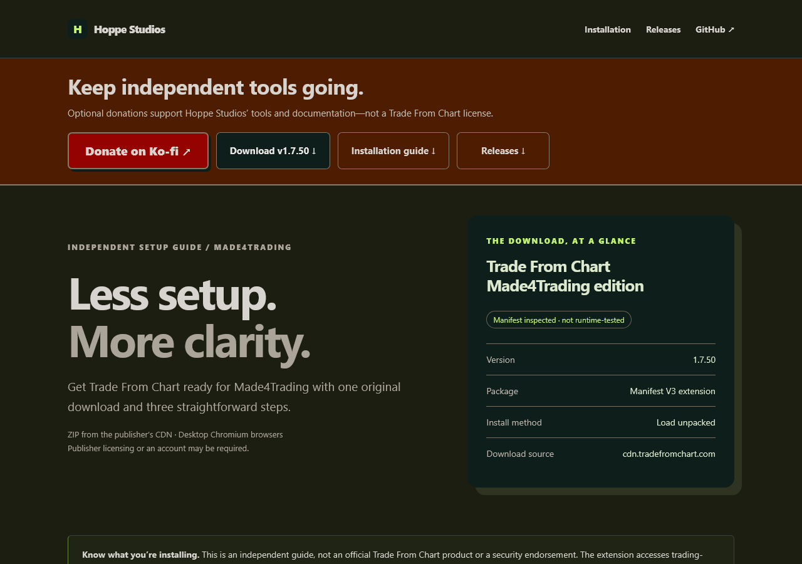
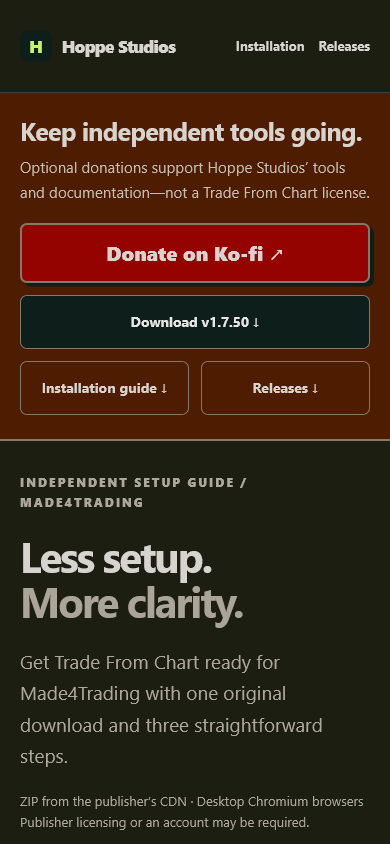

<div align="center">
  
  <h1>Trade From Chart<br>Installation Guide</h1>
  <p><strong>One original download. Clear setup steps. An independent guide.</strong></p>
  <p>By Hoppe Studios · for the Trade From Chart / Made4Trading extension</p>
  <p></p>
  <a href="https://ko-fi.com/hoppestudios"></a>
  <p>Optional donations support independent tools and documentation—not a Trade From Chart license.</p>
  <p><strong><a href="https://hoppestudios.github.io/trade-from-chart-guide/">Open the guide ↗</a> · <a href="https://cdn.tradefromchart.com/TFC_v1.7.50_24.11.26_M4T.zip">Download upstream ZIP ↓</a> · <a href="https://hoppestudios.github.io/trade-from-chart-guide/#install">Installation steps</a> · <a href="https://github.com/HoppeStudios/trade-from-chart-guide/releases/tag/guide-v1.0.0">Guide release v1.0.0</a></strong></p>
  <p><a href="CONTRIBUTING.md">Contributing</a> · <a href="CODE_OF_CONDUCT.md">Code of conduct</a> · <a href="SECURITY.md">Security</a> · <a href="LICENSE">License</a></p>
</div>

---

## A guide, not the extension

This repository is Hoppe Studios’ independent installation website for the supplied **Trade From Chart v1.7.50 / Made4Trading** ZIP. It is not the extension, a trading service or an official publisher project. We are not affiliated with the product’s publisher.

- **Read online:** the public guide is hosted on GitHub Pages. No PC hosting, server installation or local copy is needed to use the website.
- **Install separately:** the download link goes directly to the publisher’s CDN. No extension binary or third-party extension source is mirrored here.
- **Know the limits:** the archive manifest and selected integration files were inspected without execution. This is not a security certification or a claim of successful runtime operation. A matching checksum proves byte identity, not safety or publisher authenticity.

The local badges describe the guide; they are not live build, coverage or security indicators. **Guide v1.0.0** and **extension v1.7.50** are separate versions; neither badge nor download link claims the extension is the latest release.

## Quick start · install the extension

1. **Download and extract.** Get the [upstream v1.7.50 ZIP](https://cdn.tradefromchart.com/TFC_v1.7.50_24.11.26_M4T.zip). On Windows, choose **Extract All**. Keep the extracted files in a permanent location and locate the folder containing `manifest.json`.
2. **Load unpacked.** Open `chrome://extensions`, `edge://extensions` or `brave://extensions` in your desktop browser. Enable **Developer mode**, choose **Load unpacked**, then select the folder containing `manifest.json`—not the ZIP or its parent folder.
3. **Open your chart.** Confirm the extension is enabled, then open or refresh your [Made4Trading](https://made4trading.com/) chart. Complete any publisher login or licensing requirements. Check behavior on a **demo account before live use**.

These are standard Chromium unpacked-extension steps, not a verified compatibility guarantee. Firefox and mobile extension installation are not covered. Keep browser protections enabled; use the [publisher](https://tradefromchart.com/) for product, licensing and trading support.

**Need help?** See the guide’s [troubleshooting and permission notes](https://hoppestudios.github.io/trade-from-chart-guide/#help). For guide errors, [open an issue](https://github.com/HoppeStudios/trade-from-chart-guide/issues); never include credentials, account numbers or private trading data.

## See the guide

Screenshots of the **guide website**, not the extension running or a trading result. The mobile view is for reading the guide, not installing a mobile extension.

<table>
  <tr>
    <th width="70%">Desktop guide</th>
    <th width="30%">Mobile guide</th>
  </tr>
  <tr>
    <td valign="top"><a href=".github/assets/screenshots/desktop.png"></a></td>
    <td valign="top"><a href=".github/assets/screenshots/mobile.png"></a></td>
  </tr>
</table>

## Small by design

Plain **HTML, CSS and JavaScript**, with no dependency installation or build step. The site uses no analytics, third-party fonts or tracking scripts.

```text
index.html                         Guide, inline styles and browser JavaScript
robots.txt / sitemap.xml           Search discovery files
google14435e65ea93760b.html          Google site-ownership verification (keep deployed)
.nojekyll                          Static Pages support
.github/workflows/pages.yml         Allowlisted GitHub Pages deployment
.github/workflows/release.yml       Guide release publication
.github/assets/                    README vectors and website screenshots
KOFI-SETUP.md                       Maintainer donation setup notes
CONTRIBUTING.md / CODE_OF_CONDUCT.md Contribution and community guidelines
SECURITY.md                         Private security-reporting instructions
LICENSE / THIRD_PARTY_NOTICES.md    Guide-source license and third-party boundaries
```

### Optional local preview

To edit the guide, open `index.html` in a browser. If you already have Python installed, you can instead run this from the repository directory:

```sh
python -m http.server 8000 --bind 127.0.0.1
```

Visit **http://127.0.0.1:8000**, then stop the preview with **Ctrl+C**. This is a temporary local preview—not permanent hosting and not required to read the public guide.

### Publishing and discovery

In GitHub **Settings → Pages → Build and deployment**, select **GitHub Actions**. The pinned Pages workflow deploys only `index.html`, `robots.txt`, `sitemap.xml`, `.nojekyll` and `google14435e65ea93760b.html` on main pushes or manual dispatch. README artwork and repository policies are not part of the public-site payload. Keep the Google verification file in the deployment allowlist.

The owner has confirmed Google site ownership. **Sitemap submission and indexing are not confirmed.** Google decides whether and when to index the site; a sitemap or metadata alone is not a submission receipt.

## Contribute with care

Corrections, clearer instructions, accessibility improvements and reproducible guide-site bug reports are welcome. Read [Contributing](CONTRIBUTING.md) and the [Code of conduct](CODE_OF_CONDUCT.md) before opening a pull request. Report sensitive issues through the [Security policy](SECURITY.md), not a public issue.

When updating download information, verify the upstream manifest and archive SHA-256. Cite the evidence; do not invent changelogs, describe a supplied version as “latest” without proof, or mirror third-party archives. GitHub Releases describe **this guide**, not ownership or certification of the extension.

## License & credits

**[MIT](LICENSE) · Copyright © 2026 Hoppe Studios**, for Hoppe-authored guide/site material only. This grants no license to Trade From Chart, Made4Trading, their extension, trademarks or other third-party material. See [Third-party notices](THIRD_PARTY_NOTICES.md).

- **Hoppe Studios** — independent guide, site and original repository artwork.
- **Trade From Chart / Made4Trading and their respective owners** — the third-party products described; product rights and licensing remain with their owners.
- **[GitHub Pages](https://pages.github.com/)** — static website hosting.
- **[Ko-fi](https://ko-fi.com/hoppestudios)** — optional support for Hoppe Studios’ independent work, not extension licensing. Payment processing is not claimed as tested.
